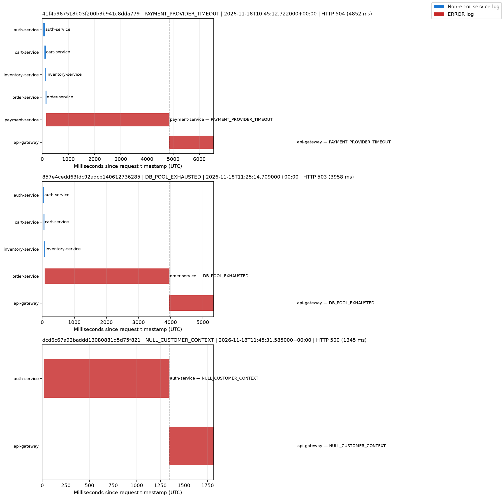

# Failed checkout trace investigation

The three examples below are actual HTTP 5xx checkout requests selected from `requests.csv` and joined to all matching records in `application_logs.csv` by `trace_id`. Records are shown in timestamp order; logged latency is the event's `latency_ms`, and elapsed time is relative to the request timestamp.

## Trace 1: `41f4a967518b03f200b3b941c8dda779`

- **Request timestamp (UTC):** 2026-11-18T10:45:12.722000+00:00
- **Request:** `POST /api/v1/checkout`
- **Region/version:** `us-east-1` / `v2.7.3`
- **HTTP status and request latency:** `504` / `4852 ms`
- **Request error code:** `PAYMENT_PROVIDER_TIMEOUT`
- **Microservice sequence from log timestamps:** auth-service → cart-service → inventory-service → order-service → payment-service → api-gateway
- **Earliest failure evidence:** `2026-11-18T10:45:12.872000+00:00` — `payment-service` / `payment.gateway.timeout` / `PAYMENT_PROVIDER_TIMEOUT` (HTTP `504` if available).

| Event timestamp (UTC) | Elapsed from request (ms) | Service | Event | Level | Error code | Log latency (ms) | HTTP status |
| --- | ---: | --- | --- | --- | --- | ---: | ---: |
| 2026-11-18T10:45:12.751000+00:00 | 29.0 | auth-service | request.completed | INFO | — | 63 | 200 |
| 2026-11-18T10:45:12.814000+00:00 | 92.0 | cart-service | request.completed | INFO | — | 32 | 200 |
| 2026-11-18T10:45:12.846000+00:00 | 124.0 | inventory-service | request.completed | INFO | — | 15 | 200 |
| 2026-11-18T10:45:12.861000+00:00 | 139.0 | order-service | request.completed | INFO | — | 11 | 200 |
| 2026-11-18T10:45:12.872000+00:00 | 150.0 | payment-service | payment.gateway.timeout | ERROR | PAYMENT_PROVIDER_TIMEOUT | 4702 | 504 |
| 2026-11-18T10:45:17.578000+00:00 | 4856.0 | api-gateway | http.response | ERROR | PAYMENT_PROVIDER_TIMEOUT | 4852 | 504 |

## Trace 2: `857e4cedd63fdc92adcb140612736285`

- **Request timestamp (UTC):** 2026-11-18T11:25:14.709000+00:00
- **Request:** `POST /api/v1/checkout`
- **Region/version:** `us-east-1` / `v2.7.3`
- **HTTP status and request latency:** `503` / `3958 ms`
- **Request error code:** `DB_POOL_EXHAUSTED`
- **Microservice sequence from log timestamps:** auth-service → cart-service → inventory-service → order-service → api-gateway
- **Earliest failure evidence:** `2026-11-18T11:25:14.792000+00:00` — `order-service` / `db.pool.exhausted` / `DB_POOL_EXHAUSTED` (HTTP `503` if available).

| Event timestamp (UTC) | Elapsed from request (ms) | Service | Event | Level | Error code | Log latency (ms) | HTTP status |
| --- | ---: | --- | --- | --- | --- | ---: | ---: |
| 2026-11-18T11:25:14.730000+00:00 | 21.0 | auth-service | request.completed | INFO | — | 26 | 200 |
| 2026-11-18T11:25:14.756000+00:00 | 47.0 | cart-service | request.completed | INFO | — | 15 | 200 |
| 2026-11-18T11:25:14.771000+00:00 | 62.0 | inventory-service | request.completed | INFO | — | 21 | 200 |
| 2026-11-18T11:25:14.792000+00:00 | 83.0 | order-service | db.pool.exhausted | ERROR | DB_POOL_EXHAUSTED | 3875 | 503 |
| 2026-11-18T11:25:18.671000+00:00 | 3962.0 | api-gateway | http.response | ERROR | DB_POOL_EXHAUSTED | 3958 | 503 |

## Trace 3: `dcd6c67a92baddd13080881d5d75f821`

- **Request timestamp (UTC):** 2026-11-18T11:45:31.585000+00:00
- **Request:** `POST /api/v1/checkout`
- **Region/version:** `us-east-1` / `v2.8.0`
- **HTTP status and request latency:** `500` / `1345 ms`
- **Request error code:** `NULL_CUSTOMER_CONTEXT`
- **Microservice sequence from log timestamps:** auth-service → api-gateway
- **Earliest failure evidence:** `2026-11-18T11:45:31.603000+00:00` — `auth-service` / `application.exception` / `NULL_CUSTOMER_CONTEXT` (HTTP `500` if available).

| Event timestamp (UTC) | Elapsed from request (ms) | Service | Event | Level | Error code | Log latency (ms) | HTTP status |
| --- | ---: | --- | --- | --- | --- | ---: | ---: |
| 2026-11-18T11:45:31.603000+00:00 | 18.0 | auth-service | application.exception | ERROR | NULL_CUSTOMER_CONTEXT | 1327 | 500 |
| 2026-11-18T11:45:32.934000+00:00 | 1349.0 | api-gateway | http.response | ERROR | NULL_CUSTOMER_CONTEXT | 1345 | 500 |

## Interpretation

For each trace, the earliest timestamped `ERROR` log is the first direct failure evidence in the available application logs. Later gateway `http.response` records report the resulting HTTP failure and should not be mistaken for an earlier originating event. Trace ordering identifies the earliest observed service-side failure, but does not by itself establish the underlying root cause.
