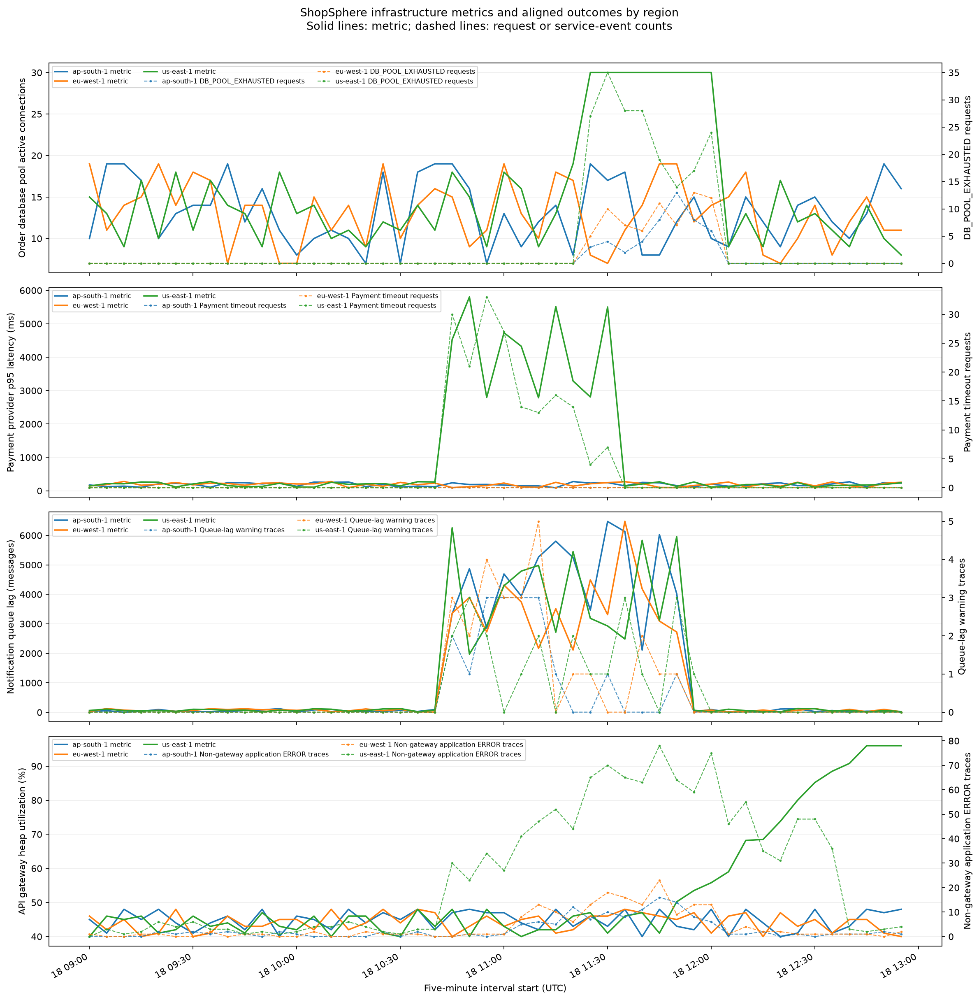

# ShopSphere metric correlation investigation

## Method

Request, application-log, and metric timestamps were normalized to five-minute UTC interval starts and joined by both interval and region. The evidence CSV contains all 144 region-interval joins. Request failures come from `requests.csv`; service indicators use matching application events and distinct `trace_id` values. Gateway response records are excluded from service error-trace counts to avoid counting the same propagated failure twice.

The reported Pearson coefficients describe association across region-interval rows only. They are not causal estimates, do not control for other conditions, and can be affected by regional or temporal clustering. A missing / constant signal has no defined coefficient.

## Correlation summary

| metric | outcome | pearson_correlation | aligned_region_intervals |
| --- | --- | --- | --- |
| db_pool_active | request_db_pool_exhausted | 0.637 | 144 |
| provider_p95_ms | request_payment_timeouts | 0.853 | 144 |
| queue_lag_messages | notification_lag_traces | 0.602 | 144 |
| queue_lag_messages | request_5xx | 0.197 | 144 |
| heap_used_pct | app_error_traces | 0.228 | 144 |
| heap_used_pct | request_5xx | 0.332 | 144 |

## Evidence table

Rows show peak metric intervals and intervals with high paired request/log counts. DB and payment request counts are sourced from request error codes; service-log trace counts are grouped independently by service, error code, and interval. A small mismatch at five-minute boundaries is possible because a request and its log event can fall into adjacent buckets. Notification queue warnings are WARN events, not HTTP failures.

| signal | interval_utc | region | metric_value | request_indicator | request_indicator_count | service_log_indicator | service_log_trace_count | all_request_5xx | application_error_traces |
| --- | --- | --- | --- | --- | --- | --- | --- | --- | --- |
| Database pool | 2026-11-18T11:25:00+00:00 | us-east-1 | 30.00 | request_db_pool_exhausted | 27 | db_pool_error_traces | 27 | 32 | 65 |
| Database pool | 2026-11-18T11:30:00+00:00 | us-east-1 | 30.00 | request_db_pool_exhausted | 35 | db_pool_error_traces | 35 | 45 | 70 |
| Database pool | 2026-11-18T11:35:00+00:00 | us-east-1 | 30.00 | request_db_pool_exhausted | 28 | db_pool_error_traces | 28 | 32 | 65 |
| Payment provider | 2026-11-18T10:50:00+00:00 | us-east-1 | 5804.00 | request_payment_timeouts | 21 | payment_timeout_traces | 21 | 23 | 23 |
| Payment provider | 2026-11-18T11:15:00+00:00 | us-east-1 | 5516.00 | request_payment_timeouts | 16 | payment_timeout_traces | 17 | 20 | 52 |
| Payment provider | 2026-11-18T10:55:00+00:00 | us-east-1 | 2796.00 | request_payment_timeouts | 33 | payment_timeout_traces | 33 | 34 | 34 |
| Payment provider | 2026-11-18T10:45:00+00:00 | us-east-1 | 4529.00 | request_payment_timeouts | 30 | payment_timeout_traces | 30 | 30 | 30 |
| Notification queue | 2026-11-18T11:35:00+00:00 | eu-west-1 | 6476.00 | request_5xx | 9 | notification_lag_traces | 0 | 9 | 16 |
| Notification queue | 2026-11-18T11:30:00+00:00 | ap-south-1 | 6470.00 | request_5xx | 4 | notification_lag_traces | 1 | 4 | 10 |
| Notification queue | 2026-11-18T12:00:00+00:00 | us-east-1 | 19.00 | request_5xx | 75 | notification_lag_traces | 0 | 75 | 75 |
| Notification queue | 2026-11-18T11:50:00+00:00 | us-east-1 | 5955.00 | request_5xx | 64 | notification_lag_traces | 3 | 64 | 64 |
| Notification queue | 2026-11-18T11:10:00+00:00 | eu-west-1 | 2169.00 | request_5xx | 2 | notification_lag_traces | 5 | 2 | 13 |
| Notification queue | 2026-11-18T10:55:00+00:00 | eu-west-1 | 2727.00 | request_5xx | 1 | notification_lag_traces | 4 | 1 | 1 |
| API gateway heap | 2026-11-18T12:45:00+00:00 | us-east-1 | 96.00 | request_5xx | 2 | app_error_traces | 2 | 2 | 2 |
| API gateway heap | 2026-11-18T12:50:00+00:00 | us-east-1 | 96.00 | request_5xx | 3 | app_error_traces | 3 | 3 | 3 |
| API gateway heap | 2026-11-18T12:00:00+00:00 | us-east-1 | 55.80 | request_5xx | 75 | app_error_traces | 75 | 75 | 75 |
| API gateway heap | 2026-11-18T11:50:00+00:00 | us-east-1 | 50.20 | request_5xx | 64 | app_error_traces | 64 | 64 | 64 |
| API gateway heap | 2026-11-18T11:45:00+00:00 | us-east-1 | 41.00 | request_5xx | 63 | app_error_traces | 78 | 63 | 78 |

The full aligned interval dataset is available in [`metric_correlation_evidence.csv`](./metric_correlation_evidence.csv).

## Findings and limitations

### Database connections and `DB_POOL_EXHAUSTED`

Compare `db_pool_active` against `request_db_pool_exhausted` and `db_pool_error_traces`. `db_pool_active` reaches 30 connections in `us-east-1` at 11:25, 11:30, and 11:35 UTC; request-level `DB_POOL_EXHAUSTED` counts in those buckets are 27, 35, and 28. Across all 144 region-intervals, the Pearson correlation is 0.637. The 311 order-service `DB_POOL_EXHAUSTED` records also report `pool_active=30` and `pool_max=30`, direct evidence that the pool was at its application-reported limit when those errors were logged. Neither this observation nor the correlation explains why connections were occupied or establishes the initiating cause.

### Payment provider latency and payment timeouts

Provider p95 latency and request-level payment timeout counts have the strongest aligned relationship measured here (Pearson 0.853 across the 144 region-intervals). At 10:50 UTC in `us-east-1`, provider p95 reaches 5,804 ms and 21 requests have `PAYMENT_PROVIDER_TIMEOUT` (23 total 5xx requests). Matching `payment-service` timeout events are also present. These associations do not prove whether provider behavior initiated the degradation or whether another condition contributed to both.

### Notification queue backlog

`queue_lag_messages` rises substantially and `notification-worker` `queue.consumer.lag` WARN traces are present. These indicate delayed asynchronous work. The queue-lag metric and distinct warning traces have Pearson correlation 0.602; correlation with request 5xx counts is only 0.197. The metric's maximum is 6,476 messages in `eu-west-1` at 11:35 UTC. Queue lag does not itself establish a checkout failure: the WARN events are distinct from request-level HTTP 5xx records and may indicate delayed downstream email after order processing.

### Memory utilization and application failures

The heap metric's correlation is weaker than payment latency: Pearson 0.228 with non-gateway application ERROR traces and 0.332 with request 5xx counts. Heap reaches 96% in `us-east-1` from 12:45–12:55, when the corresponding buckets have only 2–4 HTTP 5xx requests. Earlier high-failure buckets include 11:45–12:00, before this heap peak. The timing does not demonstrate that memory utilization caused the failures; heap/GC telemetry and process-level evidence would be needed to assess that hypothesis.

## Causality caveat

These results establish time-and-region co-occurrence only. Correlated signals may share a common cause, have a lag, or be unrelated. Confirm causality with trace/span ordering, database and provider telemetry, deployment timelines, and controlled follow-up rather than inferring a root cause from correlation coefficients.
