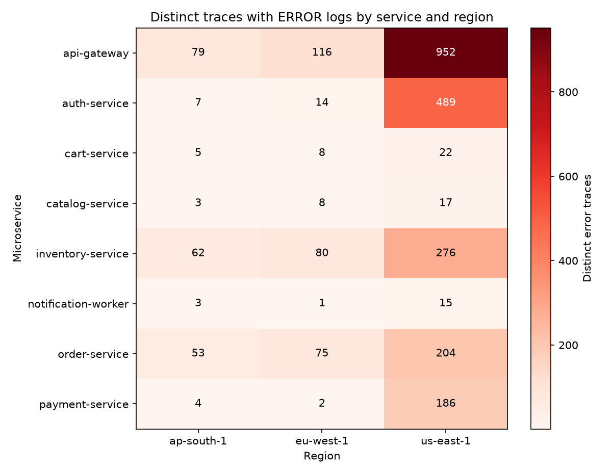

# ShopSphere application log service analysis

This report analyzes `application_logs.csv` records whose `level` is `ERROR`. It reports both ERROR log events and unique `trace_id` counts. An error trace can appear under multiple services, so service counts must not be summed to estimate unique failed requests.

## Overall counts

- Application log records: 42,354
- ERROR log events: 2,681
- Distinct traces containing an ERROR: 1,534
- Distinct traces with an ERROR at `api-gateway`: 1,147

## ERROR counts by microservice

| service | error_events | affected_traces |
| --- | --- | --- |
| api-gateway | 1147 | 1147 |
| auth-service | 510 | 510 |
| inventory-service | 418 | 418 |
| order-service | 332 | 332 |
| payment-service | 192 | 192 |
| cart-service | 35 | 35 |
| catalog-service | 28 | 28 |
| notification-worker | 19 | 19 |

## Service-versus-region heatmap

Values are distinct traces with an ERROR for that service and region (not raw log-event counts). A trace appearing in multiple services is shown in each relevant service cell, so do not sum across services.

## Grouping by service, region, event, log level, and error code

Each row below is one combination of the requested fields. `affected_traces` de-duplicates repeated records within that combination.

| service | region | event | level | error_code | error_events | affected_traces |
| --- | --- | --- | --- | --- | --- | --- |
| api-gateway | us-east-1 | http.response | ERROR | NULL_CUSTOMER_CONTEXT | 460 | 460 |
| auth-service | us-east-1 | application.exception | ERROR | NULL_CUSTOMER_CONTEXT | 460 | 460 |
| inventory-service | us-east-1 | inventory.tx.deadlock | ERROR | INVENTORY_DEADLOCK | 257 | 257 |
| api-gateway | us-east-1 | http.response | ERROR | DB_POOL_EXHAUSTED | 192 | 192 |
| order-service | us-east-1 | db.pool.exhausted | ERROR | DB_POOL_EXHAUSTED | 192 | 192 |
| api-gateway | us-east-1 | http.response | ERROR | PAYMENT_PROVIDER_TIMEOUT | 179 | 179 |
| payment-service | us-east-1 | payment.gateway.timeout | ERROR | PAYMENT_PROVIDER_TIMEOUT | 179 | 179 |
| api-gateway | us-east-1 | http.response | ERROR | TRANSIENT_FAILURE | 121 | 121 |
| inventory-service | eu-west-1 | inventory.tx.deadlock | ERROR | INVENTORY_DEADLOCK | 72 | 72 |
| api-gateway | eu-west-1 | http.response | ERROR | DB_POOL_EXHAUSTED | 71 | 71 |
| order-service | eu-west-1 | db.pool.exhausted | ERROR | DB_POOL_EXHAUSTED | 71 | 71 |
| inventory-service | ap-south-1 | inventory.tx.deadlock | ERROR | INVENTORY_DEADLOCK | 58 | 58 |
| api-gateway | ap-south-1 | http.response | ERROR | DB_POOL_EXHAUSTED | 48 | 48 |
| order-service | ap-south-1 | db.pool.exhausted | ERROR | DB_POOL_EXHAUSTED | 48 | 48 |
| api-gateway | eu-west-1 | http.response | ERROR | TRANSIENT_FAILURE | 45 | 45 |
| api-gateway | ap-south-1 | http.response | ERROR | TRANSIENT_FAILURE | 31 | 31 |
| auth-service | us-east-1 | application.error | ERROR | TRANSIENT_FAILURE | 29 | 29 |
| cart-service | us-east-1 | application.error | ERROR | TRANSIENT_FAILURE | 22 | 22 |
| inventory-service | us-east-1 | application.error | ERROR | TRANSIENT_FAILURE | 19 | 19 |
| catalog-service | us-east-1 | application.error | ERROR | TRANSIENT_FAILURE | 17 | 17 |
| notification-worker | us-east-1 | application.error | ERROR | TRANSIENT_FAILURE | 15 | 15 |
| auth-service | eu-west-1 | application.error | ERROR | TRANSIENT_FAILURE | 14 | 14 |
| order-service | us-east-1 | application.error | ERROR | TRANSIENT_FAILURE | 12 | 12 |
| cart-service | eu-west-1 | application.error | ERROR | TRANSIENT_FAILURE | 8 | 8 |
| catalog-service | eu-west-1 | application.error | ERROR | TRANSIENT_FAILURE | 8 | 8 |
| inventory-service | eu-west-1 | application.error | ERROR | TRANSIENT_FAILURE | 8 | 8 |
| auth-service | ap-south-1 | application.error | ERROR | TRANSIENT_FAILURE | 7 | 7 |
| payment-service | us-east-1 | application.error | ERROR | TRANSIENT_FAILURE | 7 | 7 |
| cart-service | ap-south-1 | application.error | ERROR | TRANSIENT_FAILURE | 5 | 5 |
| order-service | ap-south-1 | application.error | ERROR | TRANSIENT_FAILURE | 5 | 5 |
| inventory-service | ap-south-1 | application.error | ERROR | TRANSIENT_FAILURE | 4 | 4 |
| order-service | eu-west-1 | application.error | ERROR | TRANSIENT_FAILURE | 4 | 4 |
| payment-service | ap-south-1 | application.error | ERROR | TRANSIENT_FAILURE | 4 | 4 |
| catalog-service | ap-south-1 | application.error | ERROR | TRANSIENT_FAILURE | 3 | 3 |
| notification-worker | ap-south-1 | application.error | ERROR | TRANSIENT_FAILURE | 3 | 3 |
| payment-service | eu-west-1 | application.error | ERROR | TRANSIENT_FAILURE | 2 | 2 |
| notification-worker | eu-west-1 | application.error | ERROR | TRANSIENT_FAILURE | 1 | 1 |

## Ranked error codes

Ranked by distinct affected traces, then ERROR log-event count. A code can have multiple records for the same trace in different services.

| error_code | error_log_events | affected_traces | services | events |
| --- | --- | --- | --- | --- |
| NULL_CUSTOMER_CONTEXT | 920 | 460 | api-gateway, auth-service | application.exception, http.response |
| INVENTORY_DEADLOCK | 387 | 387 | inventory-service | inventory.tx.deadlock |
| DB_POOL_EXHAUSTED | 622 | 311 | api-gateway, order-service | db.pool.exhausted, http.response |
| TRANSIENT_FAILURE | 394 | 197 | api-gateway, auth-service, cart-service, catalog-service, inventory-service, notification-worker, order-service, payment-service | application.error, http.response |
| PAYMENT_PROVIDER_TIMEOUT | 358 | 179 | api-gateway, payment-service | http.response, payment.gateway.timeout |

## Is the highest-count service the source?

The gateway has the most ERROR records (1147 events across 1147 traces). Of 1147 distinct gateway ERROR traces, 1147 have an earlier non-gateway ERROR in the same trace with the same error code. This indicates the gateway is recording the outward HTTP failure after a service-level error, rather than originating those matched failures. Excluding the gateway, auth-service has the most ERROR records (510); this is the largest non-gateway count, not proof of the incident's single root cause.

Same-trace ordering supports attribution of the gateway response to a preceding service error; it does not prove a deeper infrastructure or business-logic root cause. The earliest matching service event is a proximate emitter in the logs, not necessarily the ultimate cause.

### Earlier service errors associated with gateway errors

| service | error_code | gateway_error_traces | source_events |
| --- | --- | --- | --- |
| auth-service | NULL_CUSTOMER_CONTEXT | 460 | 460 |
| order-service | DB_POOL_EXHAUSTED | 311 | 311 |
| payment-service | PAYMENT_PROVIDER_TIMEOUT | 179 | 179 |
| auth-service | TRANSIENT_FAILURE | 50 | 50 |
| cart-service | TRANSIENT_FAILURE | 35 | 35 |
| inventory-service | TRANSIENT_FAILURE | 31 | 31 |
| catalog-service | TRANSIENT_FAILURE | 28 | 28 |
| order-service | TRANSIENT_FAILURE | 21 | 21 |
| notification-worker | TRANSIENT_FAILURE | 19 | 19 |
| payment-service | TRANSIENT_FAILURE | 13 | 13 |

Supporting tables: [`service_error_groups.csv`](./service_error_groups.csv) and [`ranked_error_codes.csv`](./ranked_error_codes.csv).
